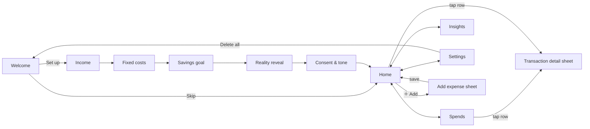

# Screen-by-Screen UX Flow

Design principles:
1. **One number first.** Every screen answers "how much can I still spend today?" before anything else.
2. **Explain, don't hide.** Any transaction that isn't counted at face value says why in one line.
3. **Thumb-first.** Primary actions sit in the bottom half; tap targets are ≥48dp.
4. **Cheap to render.** Static SVG, no animation library, virtualised lists. It has to stay smooth on a ₹8k Android phone.



Navigation is a 4-tab bar: **Today · Spends · Insights · Settings**. Sheets are used for add and detail, so the user never loses their place.

---

## 1. Onboarding (6 steps, ~60 seconds)

| Step | Screen | Key UI | Validation / notes |
|---|---|---|---|
| 0 | **Welcome**: "Your salary, but daily." | Language chips (English / Hinglish), primary *Let's set it up · 1 min*, secondary *Skip, explore with a demo profile* | Skip creates the demo persona with no consent recorded, because no real data is collected. |
| 1 | **Income**: "What lands in your account every month?" | First name, big ₹ amount field with numeric keypad | Next is disabled until income > 0. Copy: *"Just a number; no bank login."* |
| 2 | **Fixed costs**: "The money that's gone before it arrives" | Rent, EMIs, SIPs, Bills, Other fixed, with a live total | Explains that these are skipped when they appear in the bank, so nothing is counted twice. |
| 3 | **Savings**: "Pay yourself first" | 10/15/20% chips (rounded to ₹1,000) plus a custom amount | Inline error if income − fixed − savings ≤ 0. |
| 4 | **Reality reveal** 👀 | Struck-through raw ₹/day (income ÷ days) vs a large real ₹/day, with the formula shown, then "*X% smaller than it feels*" | This is the emotional hook: the gap is where the money "disappears". It also introduces rollover in one line. |
| 5 | **Consent & tone**: "Your data, your rules" | Separate toggles: 18+ (required), budgeting use (required), SMS (Android, optional), AA card (coming soon), demo month. Tone chips with a live sample notification. | *Start my day →* is enabled only when both required items are on. Each consent is purpose-specific and can be withdrawn in Settings. |

**Edge cases:** fixed + savings ≥ income blocks progress with a friendly message. Typing "1,00,000", "₹1,00,000" or "100000" all parse.

## 2. Home: the daily budget ring

```
┌────────────────────────────────────┐
│ 22 Oct · Day 22 of 31          🔥3 │
│ Good evening, Aarav 👋             │
│                                    │
│          ╭───────────╮             │
│        ╱   LEFT TODAY  ╲           │   ring drains as you spend
│       │     ₹778        │          │   green → amber (<20%) → red (over)
│        ╲   of ₹1,508   ╱           │   over budget: red arc refills to show how far over
│          ╰───────────╯             │
│   +₹56 rolled over from earlier    │
│ ┌────────────────────────────────┐ │
│ │ ₹778 left for today            │ │   status line = same copy engine as pushes
│ │ Plenty of room. Doesn't mean…  │ │   (morning <11am, midday, night ≥8pm)
│ └────────────────────────────────┘ │
│ [Spent today] [Month left] [Real/day]
│ ┌ Monthly pace ─────── ● On track ┐│   bar = spent / spendable; tick = even pace today
│ │ ███████████████▌|               ││   projection: "₹44,034 by month end"
│ └─────────────────────────────────┘│
│ Today's spends                     │
│  ☕ Third Wave Coffee   8:41  −₹250 │
│  🛺 Uber                9:05  −₹230 │
│                   [ ＋ Add expense ]│   FAB → Add-expense sheet
├────────────────────────────────────┤
│  ◎ Today   ≡ Spends   ◔ Insights  ⚙ │
└────────────────────────────────────┘
```

**States**
- *Fresh day, nothing spent:* a full green ring with "Nothing spent yet today. Iconic."
- *Under 20% left:* an amber ring; the status line nudges.
- *Over:* a red number ("₹422 over today"); the ring shows the overspend as a red arc. Tomorrow's rollover chip will read "−₹X less due to earlier overspend".
- *Danger pace:* a red pill, with the projection showing how far it eats into savings.
- *Demo:* a purple "DEMO DATA" tag until a real source is linked.

**Add-expense sheet:** a big ₹ field with autofocus, a "What was it?" field, 10 quick chips (Chai, Coffee, Blinkit, Zepto, Swiggy, Zomato, Uber, Rapido, Amazon, Auto), auto-category with override chips, a split toggle (your share), and a live "After this: ₹178 left today" line. Saving shows the post-transaction notification as an in-app toast.

## 3. Spends (transactions)

- A header explains the merge: *"Everything from your bank, SMS and manual entries, merged. Duplicates, failed payments and reversals are handled for you: 11 this month."*
- Filters: **All · Counted · Handled for you (n)**.
- Day sections with headers like `₹1,710 / ₹1,352 · ₹358 over` (red) or `✓` (green).
- Row: category icon, merchant, time · category · source (bank/SMS/manual) · "✓ you" if the user set the category, and the amount.
- Explanation line under any special row:
  - *Duplicate of bank entry · not counted twice* (struck through)
  - *Failed payment · not counted* (struck through)
  - *Reversed by bank · not counted* / *Auto-reversal of a failed debit*
  - *Refund for Amazon on 13/10 · added back* (green +)
  - *Split · your share ₹1,200 of ₹3,600*
  - *Already in your fixed costs · not counted* (dimmed)

**Transaction detail sheet** (tap any row): the amount, "Counts against budget: ₹X", the raw narration for transparency, a category grid (tapping one shows "Got it. All 6 Zepto payments, past and future, are now …"), a split share field, an "Already in my fixed costs" toggle, and delete for manual entries.

## 4. Insights: "Where did it go?"

1. **This week / month-so-far** toggle.
2. **Spent card:** the total vs budgeted, "that's 6.9 working days of work", a stacked colour bar, and per-category rows with amount, % share, count, and *hours of your life*.
3. **Top 3 leaks:** the biggest discretionary merchants (bills excluded), each with a rank, order count, average ticket, "*Zepto this month = 6 hr 19 min of your life. Worth it? Be honest.*", and a green **What if** box: "*Cut Zepto by half → ₹30,352 extra saved per year (₹2,529/month)*".
4. **Weekly reality check:** a dark, screenshot-friendly card with the date range, 🔥 streak (plus best), days under budget x/7, a **worst impulse day** box ("Sun, 18 Oct: ₹4,610 vs ₹1,648 · main character: Myntra"), the week's total, and a **Share** button. The share contains no account details.
5. **Top merchants** for the selected range.

## 5. Notification settings (inside Settings)

```
Vibe        [😏 Roast] [🌿 Gentle]      [English] [Hinglish]
Notifications
  Morning budget            (●)   [07:30] [08:30] [09:30]
  After every payment       (●)
  Night summary             (●)   [21:00] [21:30] [22:30]
  Weekly reality check      (●)   Sunday evening
PREVIEW (WITH YOUR REAL NUMBERS)
  ┌ DailyBudget · Morning · 08:30 ─────────────────────┐
  │ Good morning, Aarav! ☀️                             │
  │ Your budget today is ₹1,508 (+₹56 rolled over)…     │
  └─────────────────────────────────────────────────────┘
  (per-payment and night previews below; disabled ones fade to 40%)
```

The rest of Settings:
- **Budget:** income, savings, the fixed-cost summary, and rollover style (*Spread* / *Next day*) with a one-line explanation of each.
- **Data sources:** Account Aggregator (Connect), Bank SMS (Android), Manual (always on).
- **Privacy & your data:** a plain-language DPDP summary, consent timestamp and purposes, **Export my data**, and **Delete all my data** (with confirmation; it returns to Welcome).

## Accessibility & low-end considerations

- The ring has an accessibility label: "₹778 left today out of ₹1,508".
- Colour is never the only signal: over-budget also uses the word "over" and a minus sign.
- Hinglish is written in Latin script, the way users actually type.
- No custom fonts to download; system font only.
- All screens work offline. Data sources sync when the network returns.
