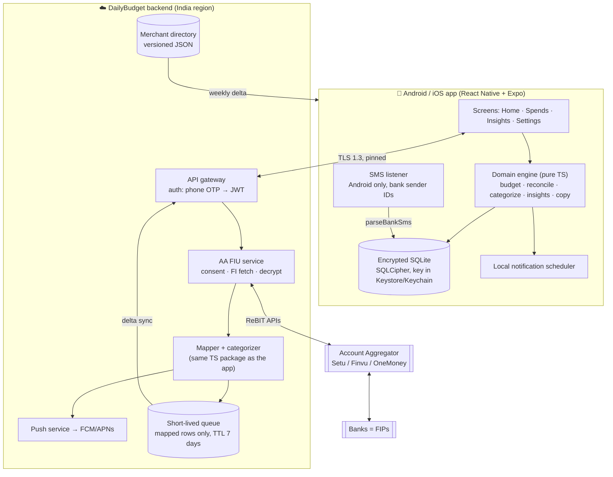
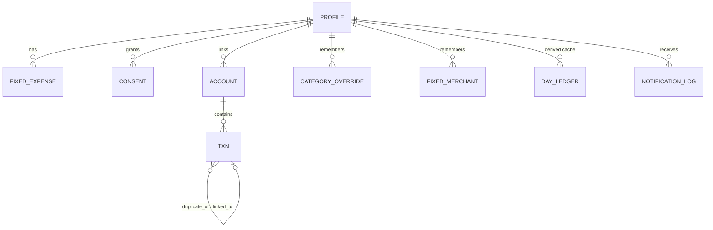
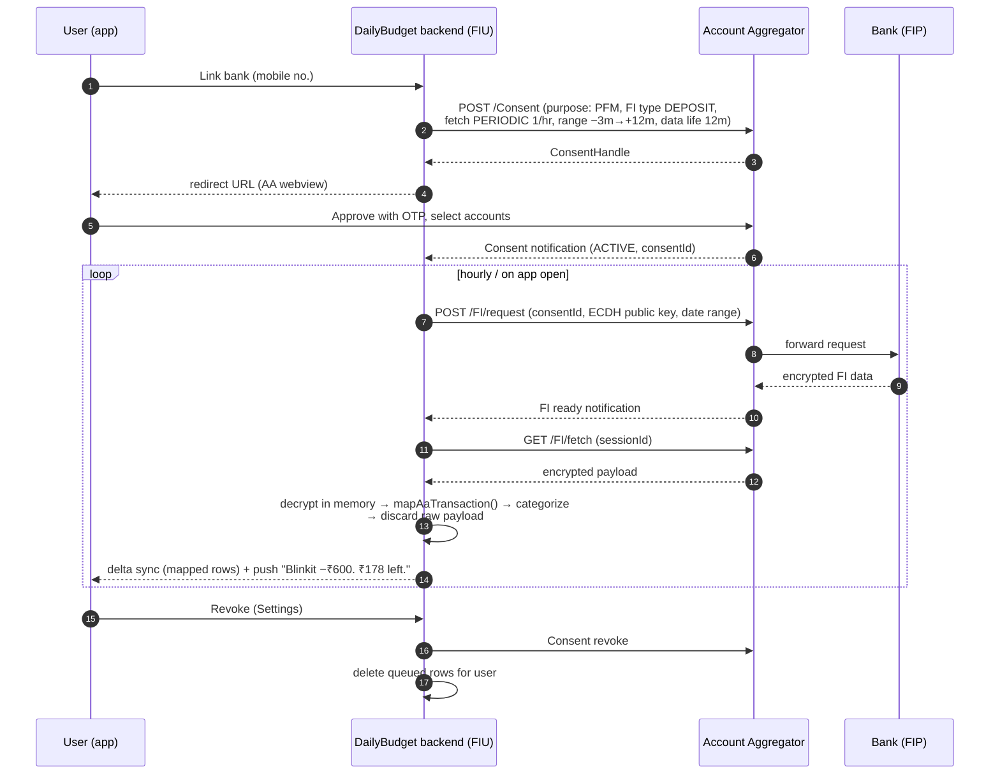

# Data Model & Architecture

## 1. Shape of the system

**Local-first.** The phone is the source of truth for budgets, ledgers and categories, and everything works offline. The backend exists only for what a phone can't do alone: being an Account Aggregator FIU (the regulated party that receives consented bank data), sending server-triggered pushes, and serving the merchant directory.



**Why local-first:** it's private by default (raw data never leaves the phone unless the user links AA), it works on bad networks, there are no per-user server costs for the core loop, and it keeps the DPDP surface area small.

## 2. Data model

All money is **integer paise**. All timestamps are ISO-8601 with an IST offset. Raw ingested rows are **immutable**: reconciliation and the daily ledger are *derived* on read, so a rule fix never needs a data migration.



| Table | Key fields | Notes |
|---|---|---|
| `profile` | `name`, `monthly_income`, `savings_goal`, `rollover_mode` (`spread`\|`nextDay`), `work_hours_per_month`, `tone`, `lang`, notification prefs | One row. Income history is versioned per month (v2) so past months don't change. |
| `fixed_expense` | `id`, `label`, `amount`, `due_day?` | Rent, EMI, SIP, bills. Subtracted up front. |
| `consent` | `purpose` (`budgeting`\|`sms`\|`aa`), `granted`, `granted_at`, `withdrawn_at`, `aa_consent_id?`, `artefact_hash?` | Purpose-specific and timestamped under DPDP. AA consent artefact ID stored for revocation. |
| `account` | `id`, `source` (`aa`\|`sms`), `fip_name`, `masked_number` (last 4), `aa_link_ref?` | No full account numbers. |
| `txn` | `id`, `source` (`aa`\|`sms`\|`manual`), `direction`, `amount`, `status` (`success`\|`pending`\|`failed`\|`reversed`), `kind` (`spend`\|`refund`\|`reversal`\|`income`\|`self_transfer`\|`fixed`), `at`, `raw_merchant`, `merchant`, `merchant_key`, `category`, `category_source` (`rule`\|`user`\|`default`), `upi_ref?`, `account_last4?`, `my_share?`, `note?` | `raw_merchant` is the narration/VPA fragment, never the full SMS. Unique on `(source, upi_ref)` where present. |
| `category_override` | `merchant_key` → `category` | "Correct once, remember forever." Applied at ingest and retroactively. |
| `fixed_merchant` | `merchant_key` | e.g. the landlord's VPA. Turns future debits into `kind=fixed`. |
| `day_ledger` *(derived)* | `date`, `budget`, `spent`, `remaining`, `rollover` | A cache for fast Home and Insights; rebuilt from `txn` when anything changes. |
| `notification_log` | `type`, `sent_at`, `template_id`, `payload_hash` | Rate limiting and dedupe (never two "over budget" pings in 30 minutes). |

Reference implementation: [`src/domain/types.ts`](../src/domain/types.ts).

## 3. Budget engine

```
spendable  = income − Σ fixed − savings_goal          (floored at 0)
base_daily = ⌊spendable ÷ days_in_month⌋
raw_daily  = ⌊income ÷ days_in_month⌋                 (shown once, in onboarding)

spread mode (default):
  budget(d) = ⌊(spendable − spent_before_d) ÷ days_left_including_d⌋

next-day mode:
  budget(d) = max(0, base_daily + Σ_{k<d}(base_daily − spent_k))

pace = spent_to_date ÷ (spendable × d ÷ days_in_month)
  ≤ 1.00 on track · ≤ 1.10 slightly over · > 1.10 danger
```

*Spread* is the default because *next-day* turns one ₹5,000 Myntra night into three ₹0 days, which is exactly the kind of punishment that makes people uninstall. Both modes are unit-tested in [`__tests__/budget.test.ts`](../__tests__/budget.test.ts).

## 4. Account Aggregator integration

DailyBudget acts as (or through a regulated partner acting as) a **Financial Information User**. Banks are **Financial Information Providers**. The AA is a consent broker that *cannot read the data*.



Key decisions:
- **We never see credentials.** The user approves on the AA's own screen.
- **Minimum consent:** FI type `DEPOSIT` only (no investments, insurance or GST), a periodic fetch, and a 12-month data life. The purpose code is personal finance management.
- **Raw FI data is never persisted.** It is decrypted in memory, mapped to the `txn` shape, and the encrypted envelope is dropped. Mapped rows sit in a queue with a 7-day TTL until the device syncs them, then they are deleted server-side.
- **Same mapper on server and client.** [`src/ingest/accountAggregator.ts`](../src/ingest/accountAggregator.ts) is plain TypeScript, unit-tested, and deployable to Node unchanged.
- **Provider abstraction:** the `AccountAggregatorClient` interface lets us swap Setu, Finvu or OneMoney. The MVP ships `stubAaClient`.
- **Eligibility:** FIUs must be regulated by RBI, SEBI, IRDAI or PFRDA. Before launch, confirm with counsel whether to partner with a regulated entity or use an AA provider's FIU-partnership model.

UPI narration example → mapped row:

```
UPI/DR/428812345678/BLINKIT/YESB/blinkit.payu@yesbank/Pay
→ { kind: spend, merchant: "Blinkit", category: quick_commerce, upiRef: "428812345678", accountLast4: "1234" }
```

## 5. Ingestion & reconciliation

Three sources feed one `txn` table:

| Source | Latency | Coverage | Reliability |
|---|---|---|---|
| AA | minutes to hours | all debits and credits on linked accounts | authoritative |
| SMS (Android) | seconds | most banks; templates vary | good; occasional duplicates and missed SMS |
| Manual | instant | cash, anything | user-dependent |

**Reconciler rules** ([`src/domain/reconcile.ts`](../src/domain/reconcile.ts)):

1. **Duplicates:** same `upi_ref` across sources, or the same amount, direction and account within 15 minutes (12 hours plus the same merchant for manual rows). Keep the most authoritative row (AA > SMS > manual) and **copy the user's edits** (category, split, note) onto it.
2. **Failed:** `status=failed` → counts ₹0, shown struck through.
3. **Reversal:** a credit that cancels a debit (matched by ref, or the same amount within 5 days) → the original becomes `reversed`, and both count ₹0.
4. **Refund:** a merchant credit → negative spend *on the day it lands* (closed days never change, so streaks stay honest). It is linked to the latest matching purchase within 60 days. On a split purchase it is pro-rated by your share.
5. **Split:** only `my_share` counts.
6. **Fixed / self-transfer / income:** never counted. Fixed is detected from ACH/NACH/SIP/EMI/investment-platform narrations, or learned when the user taps "This is a fixed cost".

## 6. Categorization engine

```
narration ─► normalize ─► user override? ─yes─► category (confidence 1.0)
                │no
                ▼
        merchant directory  (longest pattern first, word-start match)
                │miss                          "zeptomarketplace@ybl" → Zepto ✓
                ▼                              "coca cola" ↛ Ola ✓
        keyword hints ("cafe", "fuel", "electricity"…)  (confidence 0.6)
                │miss
                ▼
        Other  (confidence 0.2)  → candidates for the "Help us categorise" prompt
```

- **Directory** ([`src/domain/categorize.ts`](../src/domain/categorize.ts)): about 40 brands with legal-entity aliases (e.g. *Kiranakart* → Zepto, *Bundl Technologies* → Swiggy, *ANI Technologies* → Ola). Ordering by pattern length makes "Swiggy Instamart" win over "Swiggy" and "Amazon Prime" over "Amazon". The production directory ships as versioned JSON pulled weekly, so new brands don't need an app release.
- **P2P / unknown:** the name comes from narration segments (skipping bank codes and UPI noise) or the VPA handle. The `merchant_key` is the VPA, so a correction for `ramesh.k@oksbi` applies to every payment to Ramesh.
- **Learning loop:** a user correction becomes a `category_override` and is applied retroactively. v2: an opt-in, anonymised `(merchant_key → category)` vote to grow the shared directory. The v2 on-device ML model (merchant n-grams + amount + hour) sits *behind* overrides and *in front of* keywords.

## 7. Notifications pipeline

| Type | Trigger | Where it is computed | Works offline? |
|---|---|---|---|
| Morning | Local schedule at the user's time | Device (`morningMessage`) | ✅ |
| Per-transaction | New SMS row (instant), AA sync (push), or manual add (toast) | Device for SMS and manual; backend data-push → device renders for AA | SMS and manual ✅ |
| Night | Local schedule | Device (`nightMessage`) | ✅ |
| Weekly | Sunday 19:00 local | Device (`weeklyReality`) | ✅ |

- The **backend never composes copy with amounts**. AA pushes are *data messages* ("sync available"). The device syncs, reconciles and renders the text locally, so amounts never pass through FCM/APNs in plain text.
- Rate limits: at most 1 per-transaction alert per 2 minutes (bursts are batched as "3 payments, −₹1,140. ₹210 left."), quiet hours from 23:00 to 07:00 except the night summary, and gentle mode suggested after 3 consecutive over days.
- Copy selection is deterministic per (day, slot), so re-renders don't reshuffle messages.

## 8. Security & DPDP Act 2023 compliance

| Requirement | Implementation |
|---|---|
| Notice & explicit consent | Purpose-specific toggles in onboarding (18+, budgeting, SMS, AA), stored with timestamps. AA has its own consent artefact. |
| Purpose limitation | Data is used only for budgeting and insights. No ads, lending or data sale; this is written into the privacy notice. |
| Data minimisation | Stores amount, time, merchant, category and last-4. Raw SMS bodies and raw FI payloads are never persisted. OTP and promo SMS are dropped before parsing. |
| Encryption | At rest: SQLCipher (AES-256) with the key in Android Keystore / iOS Keychain (MVP uses AsyncStorage; this is a must-fix before public beta). In transit: TLS 1.3 with certificate pinning. Server: KMS-managed keys and India-region hosting. |
| Right to access/correct/erase | **Export my data** (JSON), edit any transaction, and **Delete all my data**, which wipes local storage immediately, revokes the AA consent, and purges server queues within 24 hours. |
| Withdraw consent | Each purpose can be toggled off in Settings. Withdrawing AA consent triggers AA revocation and data deletion. |
| Children | 18+ declaration, because minors' data needs verifiable parental consent, which we don't support. |
| Breach notification | Incident runbook: notify the Data Protection Board and affected users per the DPDP Rules timelines. |
| Grievance redressal | In-app contact plus a named grievance officer in the privacy notice. |
| Retention | Device data is kept until the user deletes it. Server mapped-row queue has a 7-day TTL. Logs are pseudonymous with a 30-day TTL. |

*The DPDP Rules phase in obligations over time; check the current timelines with counsel before launch.*

## 9. Performance on low-end Android and weak networks

- No navigation, animation or charting libraries: a hand-rolled tab bar, static SVG ring and View-based bars. The JS bundle stays small and cold start fast.
- Hermes engine with lazy screen mounting (only the active tab renders).
- `SectionList` virtualisation for Spends (`initialNumToRender=20`, `windowSize=7`).
- Derived state is memoised once per state change or minute tick. A demo month (~100 transactions) reconciles and builds its ledger in ~0.6 ms on a laptop. Expect 5–10× slower on a low-end phone, which is still far below one frame. Duplicate detection is O(n²); bucket by amount before it's needed (>1,000 transactions/month).
- Debounced persistence (400 ms) to reduce flash writes.
- Network: delta sync with a cursor; gzip; retry with backoff; everything readable offline.
- Budget: < 15 MB APK (Expo with Hermes, no heavy deps) and < 120 MB RAM on a 2 GB device.

## 10. Repository map

```
dailybudget/
├─ App.tsx                     # shell, tab bar, onboarding gate
├─ src/domain/                 # pure TS, unit-tested, shared with the backend
│  ├─ budget.ts                # plan, ledger, rollover, pace, streaks
│  ├─ reconcile.ts             # dedupe, failed, reversals, refunds, splits
│  ├─ categorize.ts            # merchant directory + resolver
│  ├─ kind.ts                  # spend vs fixed vs refund vs reversal
│  ├─ insights.ts              # breakdowns, leaks, hours of work, what-if, weekly card
│  ├─ copy.ts                  # notification copy (roast/gentle × en/hinglish)
│  └─ money.ts, dates.ts, types.ts, categories.ts
├─ src/ingest/
│  ├─ smsParser.ts             # bank SMS → Txn (on-device)
│  └─ accountAggregator.ts     # AA client interface + FI→Txn mapper
├─ src/data/seed.ts            # deterministic demo month with every edge case
├─ src/state/store.tsx         # app state, persistence, derived BudgetView
├─ src/screens/                # Onboarding, Home, Spends, Insights, Settings, sheets
├─ src/ui/                     # theme, i18n, BudgetRing, common components
└─ __tests__/                  # 40 unit tests for the domain and ingest logic
```

## 11. What it takes to go from this MVP to a beta

1. Swap AsyncStorage for encrypted SQLite (`expo-sqlite` + SQLCipher) behind the same store API.
2. `expo-notifications` for local morning, night and weekly schedules; FCM data pushes.
3. An Android SMS module (a `BroadcastReceiver` for `SMS_RECEIVED`, filtered by sender ID) feeding `parseBankSms`. This needs a dev build, not Expo Go.
4. Backend: Node/TS service hosting the FIU flow with one AA provider's sandbox, phone-OTP auth, and a delta-sync API.
5. Play Store Permissions Declaration for SMS. Privacy policy and grievance officer.
